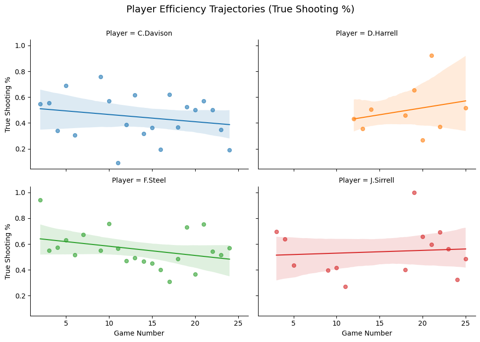
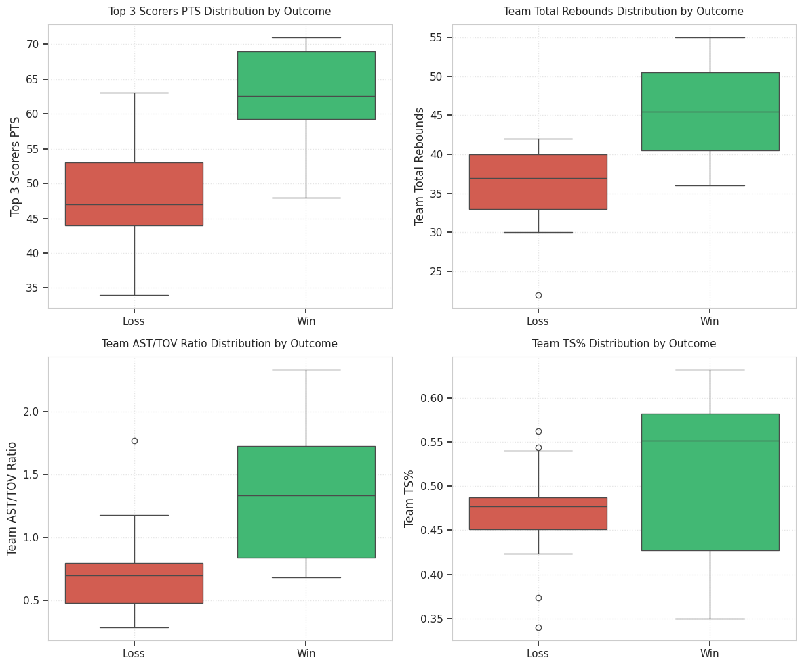
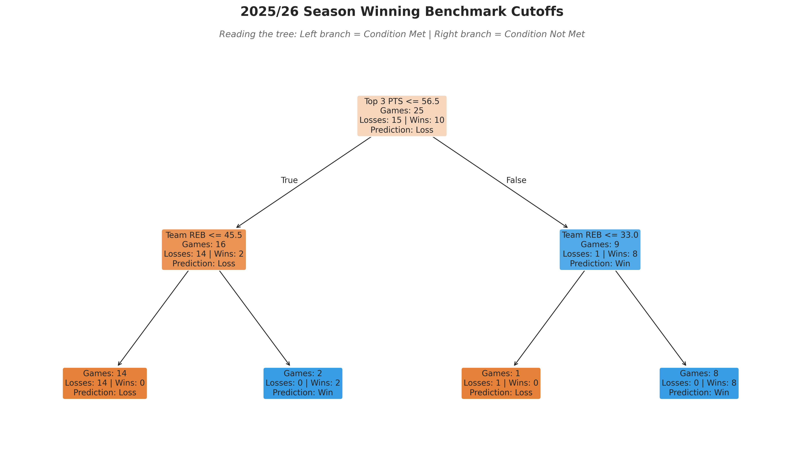

# Dunfermline Reign Basketball Performance Analysis

## 2025/26 Season

A Python-based basketball analytics project analysing player efficiency, performance trends and team-level win factors associated with winning for Dunfermline Reign Senior Men during the 2025/26 season.

The project was developed as both a practical performance-analysis tool
for an amateur basketball team and a self-directed project to develop
Python, data analysis and machine-learning skills.

---

## Project Overiew

The analysis investigated three main questions:

1. How can player scoring volume and shooting efficiency be evaluated
   together?
2. How consistent were individual player performances throughout the season?
3. Which team-level performance metrics were most strongly associated
   with winning?

The analysis used exploratory data analysis, statistical metrics,
visualisation and an interpretable decision-tree model.

---

## Key Findings

The decision-tree analysis identified three team-level variables as
important predictors of game outcomes:

| Metric | Feature Importance |
|---|---|
| Team Rebounds | 54.9% |
| Top 3 Scorers Points | 31.4% |
| Team True Shooting % | 13.7% |
| Team AST/TOV | 0.0% |

The analysis suggested that rebounds, scoring contribution from the
team's leading scorers and shooting efficiency were the most important
factors within this dataset.

These findings are specific to the team's 2025/26 season and should not
be interpreted as universal basketball benchmarks.

## Selected Results

### Player Efficiency



### Team Performance



### Decision Tree



---

## Methodology

The dataset consisted of 25 game logs:

- 23 competitive fixtures
- 2 friendlies

The analysis included:

- Data cleaning and preparation
- Player efficiency analysis using TS% and scoring volume
- Game-to-game performance analysis and moving averages
- Team-level statistical comparisons
- Decision-tree classification of game outcomes
- Data visualisation and interpretation

The full methodology and results are presented in the accompanying report.

---

## Technologies

- Python
- pandas
- NumPy
- Matplotlib
- Seaborn
- statsmodels
- scikit-learn
- Jupyter Notebook
- Google Colab
- Excel
- LaTeX

---

## Data Privacy

The original dataset is not included in this repository because it
contains private player and team information.

The analysis, code, visualisations and final report are provided to
demonstrate the methodology and findings without making the underlying
dataset publicly available.

---

## Repository Structure

```text
├── README.md
├── report/
│   └── Reign_25_26_Season_Analysis.pdf
├── notebooks/
│   └── Reign_Season_Analysis_25_26.ipynb
├── figures/
└── data/
    └── README.md